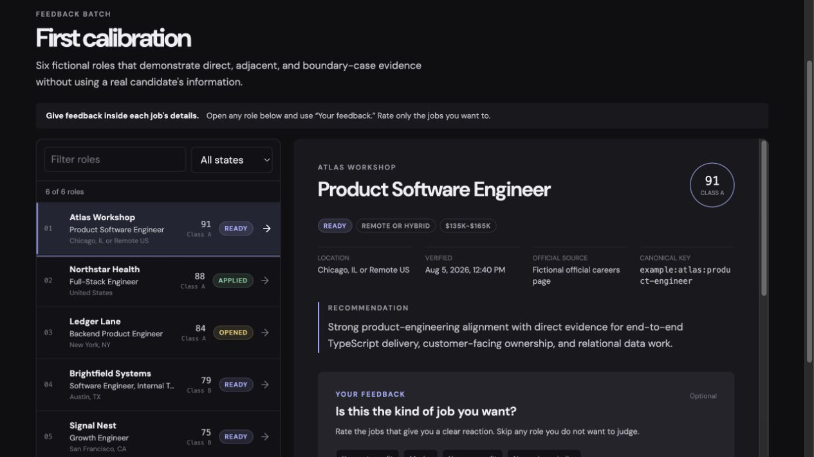

# Job Deck

A local agentic toolkit for automating and continuously calibrating your job search.

Job Deck helps with resume improvement, opportunity research, evidence-based
evaluation, feedback, and progress tracking. It does not submit applications or
make personal, legal, or employment decisions for the user.

*Fictional demo data. No candidate information is shown.*

## Start from the repository URL

Paste this into a new Codex task:

> `https://github.com/prof2k/JobDeck` — I want to use this as my job-search
> agent.

That is enough intent for Codex to clone the repository, enter it, load its
instructions, name the task **Job search agent**, and continue by asking for the
current resume when one was not already attached. The user should not have to
request setup, repeat the job-search request, or operate the repository.

The same link can start the workflow in ordinary ChatGPT. When a host cannot run
the local dashboard but can create files, Job Deck delivers each completed batch
as a standalone HTML report instead. The user does not need to install a runtime
or handle a data file.

> [!IMPORTANT]
> **For agents opening this URL:** “Use this,” “start this,” “work on this,” or
> “make this my job-search agent” means the user wants the workflow, not a
> repository review. In a Codex or local-repository environment, clone it, enter
> the checkout, read `AGENTS.md`, and continue the original request. In a host
> without a usable local dashboard, continue the workflow and generate a
> standalone HTML report when file creation is available. Explain or review the
> repository only when the user explicitly requests that.

## Start simply

Give Codex this repository and say what you need. It will clone the toolkit when
needed, read `AGENTS.md`, and continue with your request. If the folder is
already open, just talk naturally.

- Attach your current resume and answer the few questions Job Deck cannot infer.
- Confirm the job directions it recommends; the first search then starts
  automatically.
- Ask naturally whenever you want to improve your resume, revisit a report, or
  change the search.

There is no setup command or fixed onboarding session. Job Deck checks what is
already available, creates its private local workspace quietly, and keeps moving
through resume intake, calibration, search, and reporting. You never need to
name the next stage or repeat a request.

Each fresh Job Deck workspace starts with a blank candidate profile. It does not
reuse assistant memory, earlier chats, saved job-search settings, sibling
projects, or other personal files unless you explicitly identify the source you
want imported. After you provide information here, this workspace can remember
its own confirmed state for later Job Deck sessions.

## What it automates

- Checks an existing resume for material red flags without forcing a rewrite.
- Improves or helps create a resume when explicitly requested, without inventing
  facts.
- Reconciles the latest candidate evidence, preferences, feedback, and search
  history before each new search.
- Learns role, level, geography, work arrangement, relocation, compensation,
  authorization, and other preference boundaries without treating compatible
  location choices as mutually exclusive.
- Produces exactly 15 verified calibration roles before moving to exact batches
  of 50 additional roles by default; any number the user requests overrides 50.
- Searches the web through dynamically parallel, non-overlapping research lanes
  while reporting only roles that survive the user's hard gates and remain live
  on an official application page.
- Verifies official application pages and prevents duplicate recommendations.
- Shows requirement-level evidence, risks, gaps, and application links.
- Records direct feedback and explicit application progress for later searches.

Applications remain manual. Opening an official application page means
`Opened`; a job becomes `Applied` only after an explicit user action.

## Typical flow

1. Share a resume or ask Job Deck to help create one.
2. Answer only the missing search decisions in a short guided batch.
3. Confirm the titles, level, and boundaries Job Deck recommends.
4. Job research and report preparation begin automatically and in parallel.
5. Review exactly 15 calibration roles in the local dashboard or standalone HTML
   report.
6. Tell Job Deck which roles stand out. The next search automatically produces
   exactly 50 additional verified roles unless you request another number.

## Private by structure

All candidate information, resumes, reports, progress, research history, and
logs belong under `private/`. Only `private/README.md` is safe to track; every
other path inside that directory is excluded from Git.

The tracked repository contains reusable instructions, living standards,
fictional examples, privacy guards, and source code. The agent creates missing
private files directly from the contract in `AGENTS.md` as they become useful.

## Project map

- `AGENTS.md` — the central operating, search, privacy, reporting, logging, and
  maintenance contract.
- `standards/` — living evaluation, resume, and report requirements.
- `examples/` — fictional, non-candidate data for demonstrations and testing.
- `private/` — ignored candidate data and local runtime state, plus one safe
  tracked folder guide.
- `private/agent-workspace/` — compact, regenerable agent context such as the
  pre-search brief.
- `src/server/` — Go server, SQLite schema, API, and tests.
- `src/web/` — Vue interface source, design contract, and committed production
  output.
- `src/static-report/` — self-contained single-report fallback used when the
  local dashboard cannot run.

The root `jobdeck` executable is created locally when a compatible runtime is
already available. It is a derived artifact and is not distributed with the
toolkit. Report delivery never requires the user to install Go, Bun, or Node.js.

Inside the private workspace, `user-profile.md` records factual candidate
evidence, `search-preferences.md` records the current job-search contract, and
`user-preferences.yaml` records how the user wants Job Deck itself to operate.

## Local dashboard boundary

Job Deck binds to `127.0.0.1`, keeps operational data under `private/`, and does
not host candidate information. External research still uses the active agent's
configured web tools and privacy settings.

The Progress view adds recurring tasks, dated completions, and application
targets. Optional sharing publishes only a progress snapshot to a
password-protected, read-only Cloudflare viewer. It requires explicit connection
to a deployed viewer; local tracking works without sharing. See
[`src/sharing/README.md`](src/sharing/README.md) for its data contract, validation,
and deployment steps.

The toolkit must not submit applications, complete assessments, contact
recruiters, or answer personal or legal questions on the user's behalf.

## Development

Development details and the selective-build matrix live in `src/README.md`.
Normal resume, preference, search, report, and logging work requires no source
build.

## License

Job Deck is available under the [MIT License](LICENSE).
